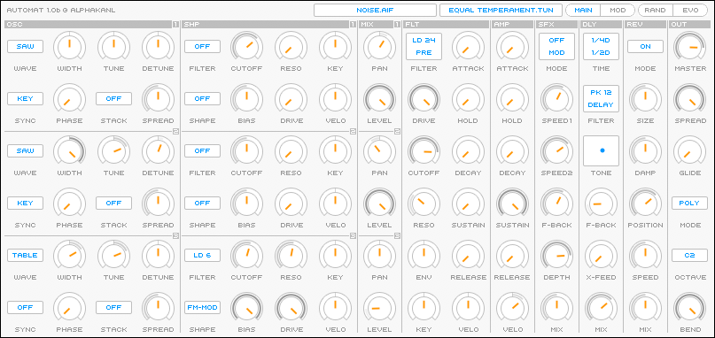
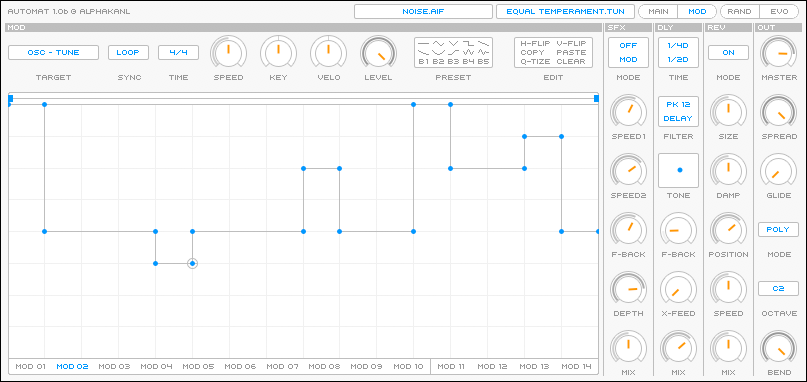

# Automat1

Automat1 is a polyphonic software synthesizer for macOS, built as an Apple
**Audio Unit** (AU instrument, `MusicDevice`) with a custom Carbon GUI.
It was developed in 2006–2008 under the *alphakanal* label and is published
here as historical source code.

> **Status:** legacy code. It targets Mac OS X 10.4/10.5, 32-bit (PPC/i386),
> Xcode 3.1 and the Carbon/Component Manager APIs. It will not build on a
> current macOS/Xcode without porting work (see [Building](#building)).

## Screenshots

**Main page:** oscillators, filter/shapers, mixer, main filter, amp envelope
and effects.

**Modulation page:** timeline editor for the 14 modulators.

## Features

**Voice architecture** (10 voices, poly / mono / legato modes)

- **3 oscillators** per voice
  - Waveforms: sine, triangle, rectangle, saw, wavetable, sample, grain, noise,
    clicks, line-in
  - Sync (key / oscillator), stacking up to 5 detuned copies
  - Band-limited waveforms using MinBLEP tables (`dsp/minblep/`)
- **3 filter/shapers**, one per oscillator
  - 17 filter types: LD 06/12/18/24, LP/HP/BP/BR/PK 12 and 24 dB, allpass 4/8,
    vowel
  - Waveshapers: tube, silicon, digital, AM and FM modulation
- **Mixer** with per-oscillator level and panorama
- **Main filter** with drive, plus filter and amp envelopes
- **Block limiter** and stereo output amplifier

**Effects**

- Stereo chorus / phaser
- Stereo delay with tempo-synced times, filter, feedback and cross-feed
- Stereo reverb

**Modulation**

- 10 per-voice modulators and 4 effect modulators, each driven by a drawable
  **timeline** curve
- Modes: loop, ping-pong, one-shot, envelope; free-running (seconds) or synced
  to host tempo (4 bars down to 1/32, dotted and triplet values)
- Key-tracking and velocity depth per modulator
- 64 voice targets and 22 effect targets, including modulator-to-modulator
  modulation
- Timeline presets and copy/paste

**Other**

- MIDI learn for all 128 controllers
- Patch randomization (*random* and *evolution* modes)
- Microtuning via `.tun` tuning files (included: equal temperament,
  Werckmeister III, Vallotti-Young, meantone, Pythagorean, and others)
- User samples and tunings loaded from
  `~/Library/Audio/Presets/alphakanal/Automat1/{samples,tunings}`

## Repository layout

| Path | Contents |
|---|---|
| `Automat.cpp/.h` | The Audio Unit: parameters, state save/restore, MIDI, rendering |
| `AutomatView.cpp/.h` | Carbon GUI (`AUCarbonViewBase`) |
| `Constants.h`, `Parameter.h` | Parameter IDs, value lists, modulation targets |
| `AutomatVersion.h`, `Automat.r`, `Info.plist` | Component IDs (`aut1` / `Alfa`), version and bundle info |
| `dsp/` | DSP engine: voices, oscillators, filters, shapers, envelopes, modulators, effects |
| `dsp/minblep/` | Precomputed MinBLEP and wavetable data |
| `resources/` | GUI images, `.nib` files, icon, tuning files |
| `layout/` | Photoshop source files for the GUI in five colour variants |
| `Automat.xcodeproj` | Xcode 3.1 project |

## Building

The Xcode project expects a 2008-era toolchain and several components that are
**not part of this repository**:

- **Apple Core Audio SDK** (`AUPublic`, `PublicUtility`) at
  `/Developer/Examples/CoreAudio/`. The voice code relies on local patches to
  the SDK's instrument base classes (marked `SDKPatch_stiwi` in the source),
  which are not included.
- **Apple HIFramework** example code at `/Developer/Examples/Carbon/HIFramework`.
- **AUGUI framework** at `../AUGuiSdk/AUGUIFramework`, which provides the
  custom controls (`TTimeLineControl`, `TViewNoCompositingCompatible`, …).
- **Font and factory samples**, removed for legal reasons. See
  [`resources/MISSING_FILES.md`](resources/MISSING_FILES.md).

With that environment (Mac OS X 10.5 SDK, Xcode 3.1), building the `Automat1`
target produces `Automat1.component`. A build phase copies it to
`~/Library/Audio/Plug-Ins/Components`.

Porting to current macOS would mean moving to the AUv2 SDK from
[CoreAudioUtilityClasses](https://developer.apple.com/library/archive/samplecode/CoreAudioUtilityClasses/)
or to AUv3, and replacing the Carbon GUI with Cocoa/AppKit.

## License

Released under the [MIT License](LICENSE).
Copyright (c) 2006–2008 Stefan Beck.
